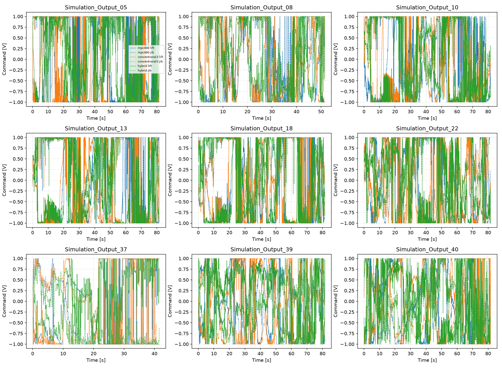

# PATU crane: training, prediction and Cartesian MPC

This package contains **17 Python scripts**: three per dynamics model, one comparison script, two MPC scripts and two neural-controller scripts. They recover the historical training routines as well as frozen-checkpoint evaluation. Every evaluation prints and saves its measured results. Raw CSVs and large prepared/teacher datasets remain external.

The controller experiments are **shared learned-model simulation**. The same selected Compact checkpoint supplies prediction and separately advanced virtual-plant dynamics. 

## Layout

```text
PATU_Crane_Research/
  README.md
  Results/
    GRU/          preprocess.py, train.py, test.py, checkpoints/, results/
    LSTM/         preprocess.py, train.py, test.py, checkpoints/, results/
    Transformer/  preprocess.py, train.py, test.py, checkpoints/, results/
    Compact/      preprocess.py, train.py, test.py, checkpoints/, results/
    Model_Comparison/  compare.py, results/
  MPC/            mpc.py, run_mpc.py, requirements.txt, configs/, checkpoints/, results/
  Neural_MPC/     train.py, test.py, checkpoints/, results/
```

No external source tree, archived historical workspace or package installation is required. The scripts use installed Python libraries and the bundled checkpoints/configuration. MPC numerical functions live directly in MPC/mpc.py; Neural_MPC imports that file. Architecture definitions and historical training functions live directly in each model's train.py. All scripts can also run from their own folders.

## Installation and data

Use **64-bit Python 3.12**; verification used Python3.12.10 on Windows. From this root:

```powershell
py -3.12 -m venv .venv
& ".\.venv\Scripts\python.exe" -m pip install -r MPC/requirements.txt
```

The following commands use `python` from that environment. Replace `D:\PATU_Data` and `D:\PATU_Cache` with your paths. All numerical entry points set OMP/OpenBLAS/MKL/Numba to one thread before numerical imports. Historical dynamics training explicitly uses its original two PyTorch threads; the controller uses one. JIT compilation/warm-up is excluded from benchmark times. Timing is hardware- and OS-dependent.

```text
D:\PATU_Data/
  Train/Simulation_Output_00.csv ... Simulation_Output_42.csv
  Test/Simulation_Output_43.csv ... Simulation_Output_53.csv
```

Two split definitions are deliberately different. **Dynamics training:** first 90% of every one of the43 Train recordings, with the last 10% of each used for validation. **Neural-controller training:**34 whole Train recordings, with nine other whole Train recordings held for validation. Test43..53 is never used for normalization fitting, dynamics training, policy training or checkpoint selection. It is described as historically reused Test because it was examined previously.

The controller validation IDs are05,08,10,13,18,22,37,39,40. Frozen split, source-size and content-hash manifests are under MPC/configs/fixtures. Controller runs use6644common100ms intervals,664.4seconds across these nine recordings. The400ms preview tail is handled by matched usable durations, not unfairly truncated differently across controllers.

## Preprocess once and share the cache

The four preprocess scripts are identical recovered implementations. They read the exact24columns, remove1800000initial rows (18s), preserve10us sampling, normalize with statistics fitted only to the90% Train prefixes, and apply the original51-sample/order3 Savitzky-Golay command smoothing. They save24-column float32 recordings and a feature schema; each model constructs the48features lazily as `concat(current,current-previous)`, avoiding duplicate huge48-column arrays. Commands remain inputs, not outputs. Physical reconstruction is `normalized*std+mean`.

```powershell
python Results/GRU/preprocess.py --data-root "D:\PATU_Data" --prepared-root "D:\PATU_Cache" --training-only
```

GRU, LSTM, Transformer and Compact can share this cache. The equivalent independent commands are:

```powershell
python Results/LSTM/preprocess.py --data-root "D:\PATU_Data" --prepared-root "D:\PATU_Cache" --training-only
python Results/Transformer/preprocess.py --data-root "D:\PATU_Data" --prepared-root "D:\PATU_Cache" --training-only
python Results/Compact/preprocess.py --data-root "D:\PATU_Data" --prepared-root "D:\PATU_Cache" --training-only
```

Omit `--training-only` to also prepare Test using Train-fitted normalization. A test script can prepare missing Test arrays itself using its selected checkpoint's scaler. `--frozen-scaler Results/GRU/checkpoints/original_scaler.json` tells preprocessing to use the frozen normalization instead of fitting it. Newly trained checkpoints embed their associated scaler. Existing compatible arrays can be supplied through `--prepared-root`; caches are outside raw Train/Test. Source-size/mtime and normalization signatures are checked. Full raw preprocessing is disk-intensive; no new scaler is fitted from Test.

The22physical outputs, in original order, are:

`speedref[rad/s]`, `speedpmsm[rad/s]`, `iqref[A]`, `udref[V]`, `uqref[V]`, `id[A]`, `iq[A]`, `psid[Wb]`, `psiq[Wb]`, `pumppressure[Pa]`, `plinepistonlift[Pa]`, `plinerodlift[Pa]`, `ppistonsidelift[Pa]`, `prodsidelift[Pa]`, `thetalift[rad]`, `plinepistonjib[Pa]`, `plinerodjib[Pa]`, `ppistonjib[Pa]`, `prodjib[Pa]`, `thetajib[rad]`, `thetaliftdot[rad/s]`, `thetajibdot[rad/s]`.

Joystick inputs are `ulift[V]` and `ujib[V]`, at original input indices0and16. The original full24-column order is defined in every preprocess.py and MPC/mpc.py.

## Train the four dynamics models

```powershell
python Results/GRU/train.py --data-root "D:\PATU_Data" --prepared-root "D:\PATU_Cache" --seed 42
python Results/LSTM/train.py --data-root "D:\PATU_Data" --prepared-root "D:\PATU_Cache" --seed 42
python Results/Transformer/train.py --data-root "D:\PATU_Data" --prepared-root "D:\PATU_Cache" --seed 42
python Results/Compact/train.py --data-root "D:\PATU_Data" --prepared-root "D:\PATU_Cache" --seed 42
```

Seed42 is the recorded original dynamics seed; `--seed44` is an explicitly different reproducibility run. GRU and LSTM retain latent12, memory16, decoder16 and a direct physical residual skip. Transformer retains width16, two heads, one layer, feedforward32, decoder16, causal history64 and dropout0. Original Compact retains latent8 and hidden32. Parameters are4098,4946,4710and4246respectively. Outputs are22state residuals added to the current normalized state with the original per-state increment scale.

Recovered training settings are60epochs, batch16,20steps/epoch, AdamW lr0.001 and weight decay1e-6, gradient clip1, gradient blocks50, and two five-step warm-up epochs. There is **no historical LR scheduler or early stopping** in these dynamics trainers. After warm-up, horizons100/500/1000are sampled with probabilities20%/60%/20%. Historical recursive burn-in is up to10000steps, with25%zero-prefix cases. Mechanical angle/velocity loss weights are4, other states1. Best checkpoint selection uses weighted500-step native validation across four fixed windows. Delta scaling is fitted from10000sampled Train-prefix pairs per file and clamped to[1e-5,1]. The recovered routines are retained without replacing these choices.

New checkpoints are separate, for example Results/GRU/checkpoints/gru_retrained_s42.pt. Frozen `*_original.pt` files are never overwritten. The output also includes its scaler, training configuration, epoch history, training_loss.csv and training_loss.png under the corresponding results/training_s42 folder. Existing named retrained checkpoints are protected against overwrite. A different seed can produce different weights and results.

`--smoke-test` executes a complete reduced3epoch run with forward/backward/optimizer steps, recursive training, validation, checkpoint saving and reload. It uses reduced batch/rollout/window counts and is clearly labelled; it does not establish full60epoch reproduction.

## Test and compare the four models

```powershell
python Results/GRU/test.py --data-root "D:\PATU_Data" --prepared-root "D:\PATU_Cache" --checkpoint original
python Results/LSTM/test.py --data-root "D:\PATU_Data" --prepared-root "D:\PATU_Cache" --checkpoint original
python Results/Transformer/test.py --data-root "D:\PATU_Data" --prepared-root "D:\PATU_Cache" --checkpoint original
python Results/Compact/test.py --data-root "D:\PATU_Data" --prepared-root "D:\PATU_Cache" --checkpoint original
python Results/Model_Comparison/compare.py
```

All11 historically reused Test recordings are evaluated. The exact established protocol uses7831origins at10000raw-sample spacing plus each final origin. One-step metrics score the first lead; recursive metrics score leads1through50 with predicted-state feedback and recorded commands only. No future measured physical state is injected. **50 raw steps at10us =0.5ms**, not500ms. Scores are per-recording metrics averaged equally across recordings per state, then equally across22states. R2 averages defined values; effectively constant states have undefined R2. Near-perfect R2 over0.5ms does not establish long-term physical accuracy.

| Frozen model | Parameters | One-step NRMSE | 50-step NRMSE |
| --- | --- | --- | --- |
| GRU | 4,098 | 5.4196491934e-06 | 1.5035229187e-04 |
| LSTM | 4,946 | 5.4138400166e-06 | 1.5311336744e-04 |
| Transformer | 4,710 | 5.7867260718e-06 | 1.5981830659e-04 |
| Compact | 4,246 | 5.3349289220e-06 | 1.4975278817e-04 |

These frozen-checkpoint Test values were recomputed and checked across every state and all 11recordings. Compact has the lowest aggregate NRMSE and wins9 of 11recordings; differences are small. Test result files under each model/results are overall.csv, per_state.csv, per_recording.csv, per_recording_per_state.csv, inference_time.csv and evaluation.json. Plots are one_step_prediction.png, recursive_prediction.png, mechanical_states.png and hydraulic_states.png, generated from actual saved Test43 predictions across its full retained time span. Inference timing reports mean/median/p95/p99/max for native calls; initial encoding, buffer setup, JIT, I/O, preprocessing and metrics are excluded.


Test a separately trained checkpoint explicitly:

```powershell
python Results/GRU/test.py --data-root "D:\PATU_Data" --prepared-root "D:\PATU_Cache" --checkpoint Results/GRU/checkpoints/gru_retrained_s42.pt
python Results/Compact/test.py --data-root "D:\PATU_Data" --prepared-root "D:\PATU_Cache" --checkpoint Results/Compact/checkpoints/compact_retrained_s42.pt
```

Retrained evaluations are saved separately by checkpoint name, retaining frozen results. The comparison reads the four default saved frozen result folders and refuses incompatible protocols. It does not convert NRMSE into an artificial accuracy percentage.

## The selected control predictor and MPC

The **9916parameter Compact** used by control is a different, frozen model. Its architecture, native recursive operator, control-conditioned head, separately normalized differences and velocity-integrated mechanical angles live in MPC/mpc.py. It predicts at10ms, not the original four models'10us. The original4246Compact training script does not train this later9916checkpoint. Reproducing MPC here uses the bundled selected checkpoint, SHA256 `590028f9aa7c1e660f4a09ec4b7563619ddcb9ebcee34eb694b589d33dc942f5`.

The exact PATU geometry uses base(-0.09,1.4261)m, lift local vector(2.886080943,0.019892554)m and jib-to-tip local vector(2.035,0.245)m. Both boom angles are absolute world-frame angles; no extra offsets are added. Source code preserves floating-point cost summation order, normalized-space clipping, original warm-start shift and best-observed feasible command selection. Raw unsmoothed command history is used for10ms plant transitions, separately from the prepared smoothed input arrays.

MPC200 uses20x10ms prediction and100/100ms move blocks. MPC400 uses40x10ms and100/300ms blocks. Both replan every100ms with SLSQP maxiter5, ftol1e-8 and finite-difference step0.03. Original objective weights are position1, angles0, angular velocity0.1, effort0.0001, command change0.001 and terminal position5; position scale0.01m. Frozen asymmetric observed command bounds are approximately[-1,1]V. Command-rate and pressure constraints remain disabled; these are experimental, not safety-certified limits.

```powershell
python MPC/run_mpc.py --data-root "D:\PATU_Data" --prepared-root "D:\PATU_Cache" --controller both
python MPC/run_mpc.py --data-root "D:\PATU_Data" --prepared-root "D:\PATU_Cache" --controller mpc200
python MPC/run_mpc.py --data-root "D:\PATU_Data" --prepared-root "D:\PATU_Cache" --controller mpc400
python MPC/run_mpc.py --verify
```

Completed saved runs are reused after duration and trajectory-hash checks. Add `--recompute` to execute them again, preserving your own previous output externally if needed. `--control-cache` can reuse the external raw-command cache; missing raw controls are prepared outside Train/Test. Every full run saves states/commands, per-decision solver diagnostics, per-recording metrics, Cartesian/mechanical plots, commands, error histories and actual computation times in MPC/results. `--smoke-test` executes two control decisions per validation recording into a separate folder.

## Train the neural command predictor: teacher generation plus imitation

Neural_MPC/train.py performs **both** teacher generation and policy training. With no reuse argument it runs the original400ms MPC teacher on the34controller-training recordings and generates a separate nine-recording Train-derived validation set. Validation examples are used only for validation; Test is never accessed by this training path. The teacher uses maxiter5, the frozen9916model, original objective/geometry/bounds, and the historical previous-second-move warm start. These labels are not substituted with canonical-zero/hold-start labels.

```powershell
python Neural_MPC/train.py --data-root "D:\PATU_Data" --prepared-root "D:\PATU_Cache" --seed 44
```

Demonstrations default to an external PATU_teacher_demonstrations folder beneath the data root, not inside the ZIP. `--demonstrations-dir` selects another destination; `--generate-only` stops before fitting. Generation is resumable by recording. Existing demonstrations can be reused:

```powershell
python Neural_MPC/train.py --data-root "D:\PATU_Data" --prepared-root "D:\PATU_Cache" --reuse-demonstrations "D:\PATU_Teacher_Demonstrations" --seed 44
```

Reuse verifies teacher configuration/dynamics hash, feature dimensions, historical feature reconstruction and warm-start recurrence. Supply the original protocol.json inside the demonstrations folder or its parent. The bundled package excludes the large teacher arrays. Full regeneration is computationally expensive because it executes32288teacher optimizations; the completed reproduction here reused validated historical demonstrations, while fresh teacher generation was checked in a bounded smoke run.

The policy is **210->128->64->2,35394parameters**, ReLU hidden layers and tanh outputs. Features are current22physical states, previous10ms22states, previous2commands, current4mechanical errors and40future desired mechanical4-vectors. The historical pipeline denormalizes with float64, concatenates, casts features tofloat32 and applies its Train-only fitted float32 scaler. That precision convention is preserved.

Recovered imitation training is Adam lr0.001, weight decay1e-5, normalized command MSE, batch512, gradient clip5, maximum240epochs, patience40 and minimum validation improvement1e-7. The best supervised-validation checkpoint is saved separately as wide_retrained_s44.pt with embedded scalers and a JSON snapshot. Training/validation curves and settings are saved in Neural_MPC/results/wide_retrained_s44. The original policy selection study compared candidates by autonomous development-validation tracking; this entry point reproduces the chosen wide architecture and seed, rather than repeating architecture search. Test is not used for selection.

The complete seed44 fit executed here stopped at72epochs on25644training and6644validation demonstrations. It was measured as **bit-identical to the historical frozen policy in both learned tensors and scalers** on this environment. That does not promise identical weights or closed-loop results for a new dataset, altered labels, another seed or another numerical environment. The historical wide_s44.pt remains the default and is never overwritten.

## Test neural-assisted MPC

```powershell
python Neural_MPC/test.py --data-root "D:\PATU_Data" --prepared-root "D:\PATU_Cache" --checkpoint original
python Neural_MPC/test.py --data-root "D:\PATU_Data" --prepared-root "D:\PATU_Cache" --checkpoint Neural_MPC/checkpoints/wide_retrained_s44.pt
```

The default compares original MPC400/maxiter5, conventional MPC400/maxiter3 and neural-assisted MPC400/maxiter3 across the complete nine development-validation recordings. The hybrid clips the policy's single command pair to the unchanged bounds, repeats it as both move-block initial guesses, optimizes the unchanged400ms cost and applies only the first100ms command. It **still performs online optimization**. Its separately advanced virtual plant uses the same frozen learned Compact dynamics, not independent physical validation. The standalone optimization-free neural policy was not a reliable replacement in the historical study.

MPC400 baseline arrays are reused from MPC/results/mpc400; the other outputs go under Neural_MPC/results. Explicitly selected retrained-policy evaluations use their own checkpoint-named subfolder. Add `--recompute` to rerun conventional3 and hybrid; the already verified MPC400 baseline is reused. Per-recording metrics and mean/pooled/worst/final/max tracking errors, saturation, solver statistics, controller mean/median/p95/p99/max, deadline misses, virtual-plant times and plots are printed and saved.

Fresh full-recording results with frozen checkpoints:

| Controller | Mean tip RMSE [mm] | Pooled RMSE [mm] | Full-run mean [ms] | p99 [ms] | 100ms deadline misses |
| --- | --- | --- | --- | --- | --- |
| mpc200 | 521.20618 | 659.06909 | 14.1859 | 37.5862 | 0.00000% |
| mpc400 | 54.75415 | 78.04149 | 41.3297 | 74.7448 | 0.00000% |
| conventional3 | 131.19501 | 227.75013 | 25.1828 | 47.4161 | 0.00000% |
| hybrid | 43.31251 | 57.92577 | 25.0777 | 44.2974 | 0.00000% |

The unique36controller trajectories (MPC200,MPC400,conventional3,hybrid x9recordings) match their previous complete state/command array hashes exactly. Full-run times above are measured, not forced to the earlier matched-context benchmark. Mean recording RMSE weights recordings equally; pooled RMSE weights prediction samples.





## What was actually executed

- All four original checkpoints: complete11recording Test evaluation; all 22state MAE/RMSE/NRMSE/R2 checked against the prior verified results.
- All four trainers: complete reduced3epoch smoke pipeline, including gradient updates, validation, checkpoint saving, reload and small checkpoint-specific Test evaluations.
- Original Compact trainer: **complete60epoch from-scratch run**, original seed42/settings, saved/reloaded checkpoint and complete11recording evaluation. Its new one-step NRMSE is5.3349289220e-06 and50-step NRMSE is1.4975278817e-04; it is not labelled as the original frozen checkpoint.
- GRU,LSTM,Transformer: **full60epoch training was not rerun**. Their recovered code and shortened training pipelines passed; this is not a claim of full-training numerical reproduction. Historical recorded training time was about5minutes each for GRU/LSTM and30minutes for Transformer on this environment.
- Neural command predictor: complete chosen-architecture training from fresh random weights using32288verified existing teacher examples;72epochs including its historical stopping criterion. Fresh teacher-label generation was smoke-tested and matched historical demonstrations exactly; the complete teacher corpus was not regenerated.
- MPC200/MPC400 and conventional3/hybrid: full nine-recording autonomous reruns with exact saved-trajectory regression.
- Full raw54CSV preprocessing was not repeated; compatible existing prepared recordings were reused. The recovered fitting/conversion kernels were checked against historical source. This is distinct from claiming a new end-to-end raw-data preparation run.

Verification details are in MPC/results/reproducibility.json and MPC/configs/training_recovery.json. Frozen hashes are in MPC/configs/checkpoint_sha256.json. There are no known missing source/dependency blockers in the tested environment; a peer still needs the original data and the listed installed packages. Retraining other models, regenerating the full teacher corpus and executing from raw CSV without existing caches remain user-run workloads, not completed experiments claimed by this ZIP.

## Quick checks

```powershell
python Results/GRU/preprocess.py --prepared-root "D:\PATU_Cache" --verify
python Results/GRU/train.py --verify
python Results/LSTM/train.py --verify
python Results/Transformer/train.py --verify
python Results/Compact/train.py --verify
python MPC/run_mpc.py --verify
python Neural_MPC/train.py --data-root "D:\PATU_Data" --prepared-root "D:\PATU_Cache" --smoke-test --seed 44
```

All scripts provide --help; the training scripts also accept --seed and --smoke-test. Checkpoints/scalers/data manifests are retained, but raw recordings, teacher arrays, environments, bytecode/JIT caches, historical source trees and logs are excluded from the ZIP. Earlier archives and original historical source/checkpoints remain unchanged. No commits or pushes were made.
