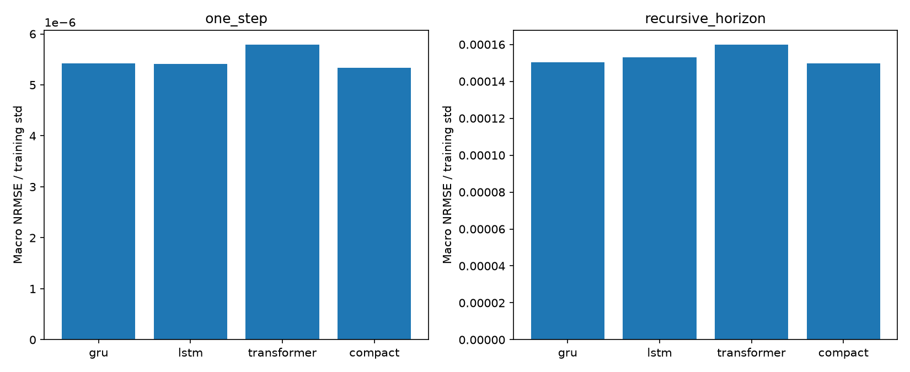
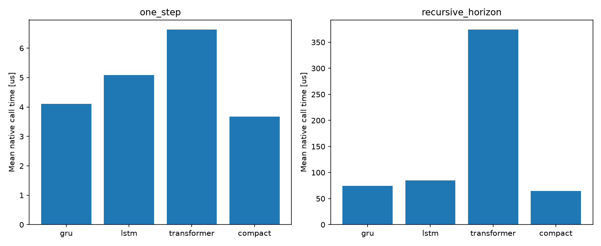
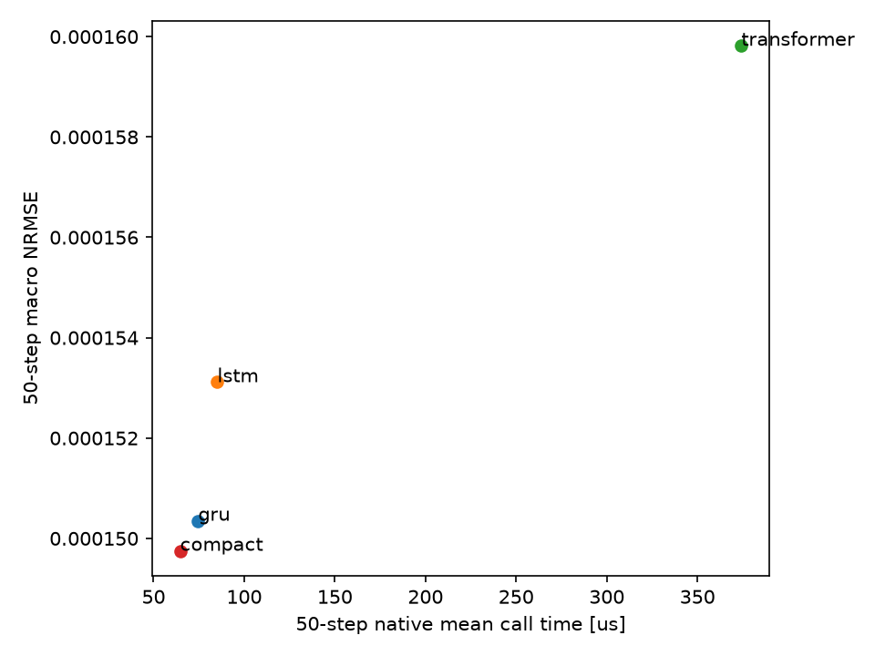
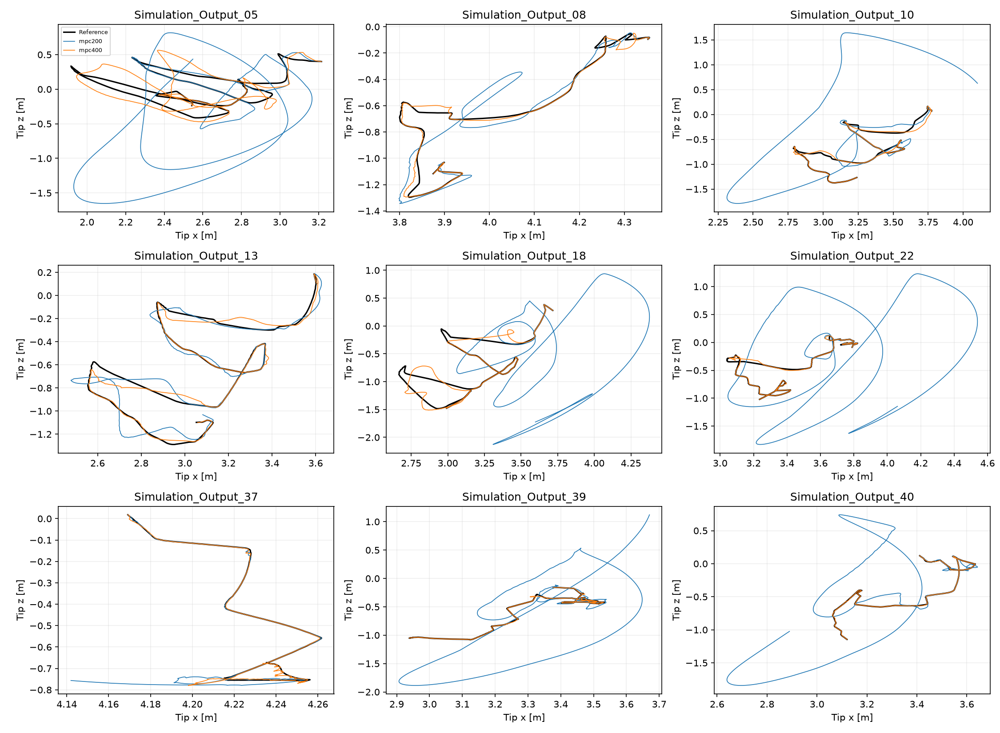
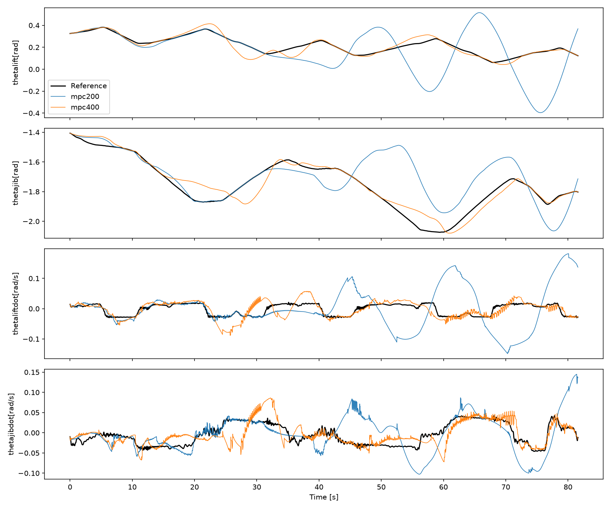
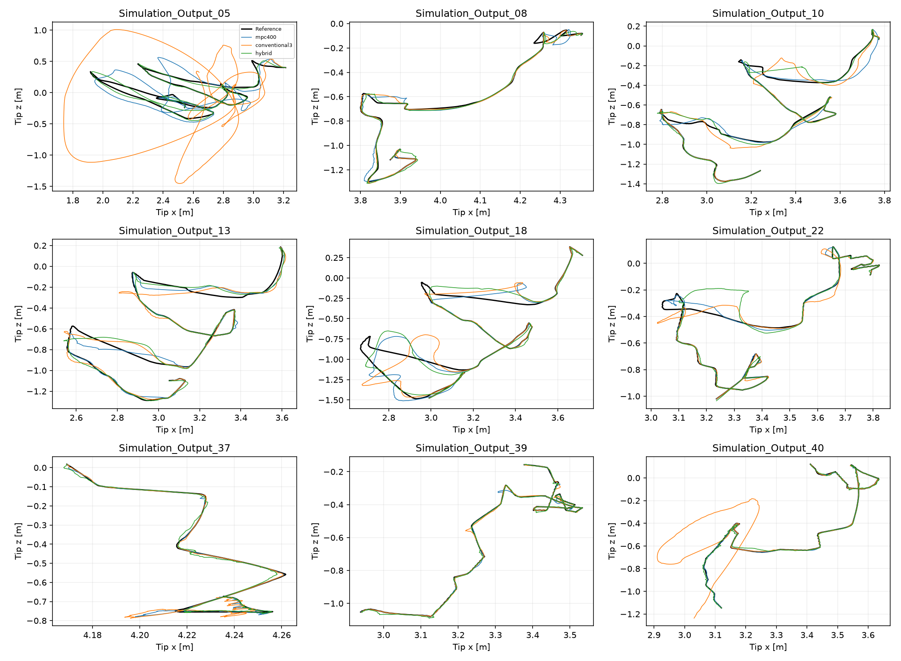
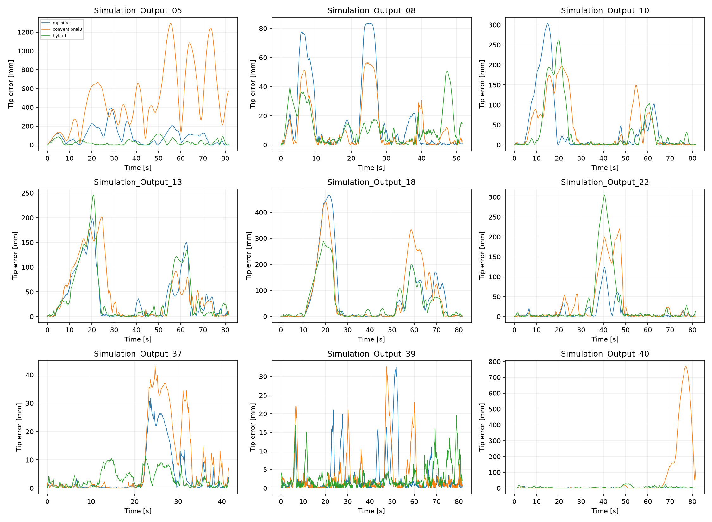
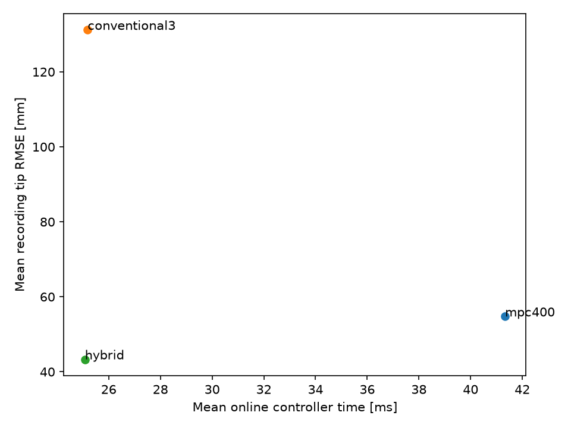

# PATU crane: training, prediction and Cartesian MPC

This package contains **17 Python scripts**: three per dynamics model, one comparison script, two MPC scripts and two neural-controller scripts. They recover the historical training routines as well as frozen-checkpoint evaluation. Every evaluation prints and saves its measured results. Raw CSVs and large prepared/teacher datasets remain external.

The controller experiments are **shared learned-model simulation**. The same selected Compact checkpoint supplies prediction and separately advanced virtual-plant dynamics. 

## Layout

```text
PATU_Crane_Research/
  README.md
  Results/
    GRU/          preprocess.py, train.py, test.py, checkpoints/, results/
    LSTM/         preprocess.py, train.py, test.py, checkpoints/, results/
    Transformer/  preprocess.py, train.py, test.py, checkpoints/, results/
    Compact/      preprocess.py, train.py, test.py, checkpoints/, results/
    Model_Comparison/  compare.py, results/
  MPC/            mpc.py, run_mpc.py, requirements.txt, configs/, checkpoints/, results/
  Neural_MPC/     train.py, test.py, checkpoints/, results/
```

No external source tree, archived historical workspace or package installation is required. The scripts use installed Python libraries and the bundled checkpoints/configuration. MPC numerical functions live directly in MPC/mpc.py; Neural_MPC imports that file. Architecture definitions and historical training functions live directly in each model's train.py. All scripts can also run from their own folders.

## Installation and data

Use **64-bit Python 3.12**; verification used Python3.12.10 on Windows. From this root:

```powershell
py -3.12 -m venv .venv
& ".\.venv\Scripts\python.exe" -m pip install -r MPC/requirements.txt
```

The following commands use `python` from that environment. Replace `D:\PATU_Data` and `D:\PATU_Cache` with your paths. All numerical entry points set OMP/OpenBLAS/MKL/Numba to one thread before numerical imports. Historical dynamics training explicitly uses its original two PyTorch threads; the controller uses one. JIT compilation/warm-up is excluded from benchmark times. Timing is hardware- and OS-dependent.

```text
D:\PATU_Data/
  Train/Simulation_Output_00.csv ... Simulation_Output_42.csv
  Test/Simulation_Output_43.csv ... Simulation_Output_53.csv
```

Two split definitions are deliberately different. **Dynamics training:** first 90% of every one of the43 Train recordings, with the last 10% of each used for validation. **Neural-controller training:**34 whole Train recordings, with nine other whole Train recordings held for validation. Test43..53 is never used for normalization fitting, dynamics training, policy training or checkpoint selection. It is described as historically reused Test because it was examined previously.

The controller validation IDs are05,08,10,13,18,22,37,39,40. Frozen split, source-size and content-hash manifests are under MPC/configs/fixtures. Controller runs use6644common100ms intervals,664.4seconds across these nine recordings. The400ms preview tail is handled by matched usable durations, not unfairly truncated differently across controllers.

## Preprocess once and share the cache

The four preprocess scripts are identical recovered implementations. They read the exact24columns, remove1800000initial rows (18s), preserve10us sampling, normalize with statistics fitted only to the90% Train prefixes, and apply the original51-sample/order3 Savitzky-Golay command smoothing. They save24-column float32 recordings and a feature schema; each model constructs the48features lazily as `concat(current,current-previous)`, avoiding duplicate huge48-column arrays. Commands remain inputs, not outputs. Physical reconstruction is `normalized*std+mean`.

```powershell
python Results/GRU/preprocess.py --data-root "D:\PATU_Data" --prepared-root "D:\PATU_Cache" --training-only
```

GRU, LSTM, Transformer and Compact can share this cache. The equivalent independent commands are:

```powershell
python Results/LSTM/preprocess.py --data-root "D:\PATU_Data" --prepared-root "D:\PATU_Cache" --training-only
python Results/Transformer/preprocess.py --data-root "D:\PATU_Data" --prepared-root "D:\PATU_Cache" --training-only
python Results/Compact/preprocess.py --data-root "D:\PATU_Data" --prepared-root "D:\PATU_Cache" --training-only
```

Omit `--training-only` to also prepare Test using Train-fitted normalization. A test script can prepare missing Test arrays itself using its selected checkpoint's scaler. `--frozen-scaler Results/GRU/checkpoints/original_scaler.json` tells preprocessing to use the frozen normalization instead of fitting it. Newly trained checkpoints embed their associated scaler. Existing compatible arrays can be supplied through `--prepared-root`; caches are outside raw Train/Test. Source-size/mtime and normalization signatures are checked. Full raw preprocessing is disk-intensive; no new scaler is fitted from Test.

The22physical outputs, in original order, are:

`speedref[rad/s]`, `speedpmsm[rad/s]`, `iqref[A]`, `udref[V]`, `uqref[V]`, `id[A]`, `iq[A]`, `psid[Wb]`, `psiq[Wb]`, `pumppressure[Pa]`, `plinepistonlift[Pa]`, `plinerodlift[Pa]`, `ppistonsidelift[Pa]`, `prodsidelift[Pa]`, `thetalift[rad]`, `plinepistonjib[Pa]`, `plinerodjib[Pa]`, `ppistonjib[Pa]`, `prodjib[Pa]`, `thetajib[rad]`, `thetaliftdot[rad/s]`, `thetajibdot[rad/s]`.

Joystick inputs are `ulift[V]` and `ujib[V]`, at original input indices0and16. The original full24-column order is defined in every preprocess.py and MPC/mpc.py.


## 2. Stage I — Neural Dynamics Modelling

The first stage of this research focuses on developing neural networks to predict the dynamic behaviour of the PATU forestry crane.

Four neural architectures were investigated:

1. Gated Recurrent Unit (GRU)
2. Long Short-Term Memory (LSTM)
3. Causal Transformer
4. Compact Recurrent Model

All four models use the same crane measurements and are trained to predict changes in the **22 physical states** under the applied lift and jib joystick commands.

The aim is to compare their prediction accuracy, computational efficiency, and ability to predict crane movement recursively.

### 2.1 Dataset and Preprocessing

The original dataset consists of 54 crane recordings containing electrical, hydraulic, and mechanical measurements.

Each recording contains:

- **22 physical states:** Including electrical signals, hydraulic pressures, lift and jib angles, and angular velocities.
- **2 joystick commands:** One controlling the lift boom and another controlling the jib boom.

The original sampling interval is **10 microseconds (10 µs)**, corresponding to 100,000 samples per second.

Before training, the data is prepared using the following steps:

1. **Startup removal:** The first 18 seconds of each recording are removed to exclude initial startup behaviour.
2. **Command smoothing:** A third-order Savitzky–Golay filter with a 51-sample window is applied to the joystick commands to reduce noise.
3. **Signal alignment:** The physical states and joystick commands are aligned so that the models receive the correct information when predicting the next state.
4. **Normalization:** The signals are normalized using parameters obtained from the training data. The same saved parameters are used during validation and testing.
5. **Dataset separation:** Training, validation, and Test recordings are kept separate to prevent future information from entering the training process.

The preprocessing also calculates changes between consecutive time steps, allowing the models to observe how the crane is moving rather than relying only on its current condition.

### 2.2 Input Feature Construction

Each model receives **48 input features**, constructed from the 22 physical states and two joystick commands.

The features are divided into two groups:

| Input Information | Features | Description |
|---|---:|---|
| Current physical states | 22 | Current electrical, hydraulic, and mechanical conditions |
| Current joystick commands | 2 | Current lift and jib control inputs |
| Changes in physical states | 22 | Difference between the current and previous physical states |
| Changes in joystick commands | 2 | Difference between the current and previous joystick commands |
| **Total** | **48** | **Complete model input** |

The first 24 features describe the crane's current condition and applied commands.

The remaining 24 features describe how those values have changed since the previous time step.

For example, the current lift angle tells the model where the lift boom is pointing, while the change in lift angle provides information about its recent movement.

Similarly, the current joystick command tells the model what input is being applied, while the change in joystick command indicates whether the operator has recently increased, decreased, or reversed that input.

These 48 features provide both current-state and recent-motion information.

All four models use these prepared features to predict the changes in the next **22 physical states**.

The predicted state changes are scaled using the saved training-derived increment scales and added to the current states to obtain the next predicted crane state.

The two joystick commands remain model inputs and are not included among the 22 predicted physical states.

### 2.3 Neural Network Architectures

The four models use different architectures to process the same input information.

#### GRU — 4,098 Parameters

The GRU receives the 48 prepared input features, which are first passed through an encoder that reduces them to **12 features**.

These encoded features are processed by a GRU recurrent unit containing **16 hidden units**.

The GRU maintains an internal memory of previous crane behaviour and updates it as new input information becomes available.

The resulting information passes through a **16-unit decoding layer**, which predicts changes in all 22 physical states.

A direct linear skip connection from the original input features also contributes to the state-change prediction.

This allows the model to use both the information stored in its recurrent memory and the current crane measurements.

#### LSTM — 4,946 Parameters

The LSTM uses the same 48 input features and a **12-feature encoder**.

The encoded information is processed by an LSTM recurrent unit containing **16 hidden units**.

Unlike the GRU, the LSTM maintains both hidden memory and cell memory. These allow it to retain useful information about previous crane movements while processing new inputs.

The recurrent output passes through a **16-unit decoding layer** to predict changes in the 22 physical states.

A direct linear skip connection from the input features is also included.

The main difference from GRU is the internal memory mechanism used to capture time-dependent crane behaviour.

#### Causal Transformer — 4,710 Parameters

The Transformer receives the same 48 input features and converts them into **16-dimensional encoded representations**.

It processes a history of up to **64 time steps** using one Transformer layer with:

- 2 attention heads.
- 16-dimensional model representations.
- A 32-unit feedforward layer.
- Causal attention.
- No dropout in the selected configuration.

The attention mechanism allows the model to identify relationships between different time steps in the available input history.

Causal attention ensures that the model cannot use future physical states when predicting an earlier state.

The processed information passes through a **16-unit decoding layer**, which predicts changes in the 22 physical states.

A direct linear skip connection from the input features also contributes to the output.

#### Original Compact Recurrent Model — 4,246 Parameters

The Compact model uses a custom recurrent architecture designed to provide accurate prediction with fewer parameters and lower computational cost.

It receives the same 48 prepared input features.

First, the model uses an encoder to represent the **22 physical states using 8 internal features**.

These internal features are updated through the model's custom recurrent mechanism using the current input information and previous internal memory.

The updated information is combined with the prepared inputs and processed through a **32-unit hidden layer**.

A decoder predicts the changes in all 22 physical states.

A direct linear skip connection also allows the original input features to contribute to the final prediction.

The predicted state changes are scaled and added to the current physical states to obtain the next predicted state.

The Compact architecture was designed to reduce model complexity while retaining the information required for recursive crane prediction.

### 2.4 Architecture Comparison

| Parameter | GRU | LSTM | Transformer | Compact |
|---|---:|---:|---:|---:|
| Input features | 48 | 48 | 48 | 48 |
| Encoder dimension | 12 | 12 | 16 | 8 (physical-state encoder) |
| Recurrent hidden units | 16 | 16 | — | Custom recurrent memory |
| Attention heads | — | — | 2 | — |
| Transformer layers | — | — | 1 | — |
| Feedforward dimension | — | — | 32 | — |
| Decoder/hidden dimension | 16 | 16 | 16 | 32 |
| Predicted physical states | 22 | 22 | 22 | 22 |
| Trainable parameters | 4,098 | 4,946 | 4,710 | 4,246 |

All models predict physical-state changes rather than directly replacing the current state with an unrelated prediction.

The original current-state information is retained when constructing the next predicted state.

### 2.5 Model Training

All four models were trained using the same general training procedure to provide a consistent comparison.

Instead of training only on individual next-state predictions, the training process includes **recursive prediction**.

During recursive prediction, the model's predicted physical states are fed back into the model to calculate later predictions.

This allows the model to learn from the errors that accumulate when its own predictions are used repeatedly.

#### Training Configuration

| Training Parameter | Value |
|---|---|
| Original sampling interval | 10 µs |
| Maximum training epochs | 60 |
| Batch size | 16 |
| Training steps per epoch | 20 |
| Optimizer | AdamW |
| Learning rate | 0.001 |
| Weight decay | 0.000001 |
| Gradient clipping | 1.0 |
| Gradient blocks | 50 steps |
| Initial warm-up | 2 epochs |
| Warm-up prediction horizon | 5 steps |
| Main training horizons | 100, 500, and 1,000 steps |
| Horizon sampling probabilities | 20%, 60%, and 20% |
| Maximum recursive burn-in | 10,000 steps |
| Zero-prefix training cases | 25% |
| Mechanical angle/velocity loss weight | 4 |
| Other physical-state loss weight | 1 |
| Original random seed | 42 |
| Learning-rate scheduler | None |
| Early stopping | None |

#### Recursive Training Horizons

After the initial warm-up, three recursive prediction horizons are used during training:

| Prediction Steps | Physical Duration | Sampling Probability |
|---|---:|---:|
| 100 steps | 1 ms | 20% |
| 500 steps | 5 ms | 60% |
| 1,000 steps | 10 ms | 20% |

This allows the networks to learn predictions over different short time intervals instead of focusing only on the next sample.

The 500-step horizon is selected most frequently during training.

#### Training Warm-up and Burn-in

The first two epochs use short five-step predictions to initialize the learning process before longer recursive sequences are introduced.

During the main training stage, historical information can also be processed through a recursive burn-in of up to 10,000 steps.

This allows recurrent models to establish their internal memory before calculating the training loss.

Some training cases use a zero-prefix configuration, allowing the models to learn under different memory initialization conditions.

#### Training Loss

The models are trained by comparing their predicted physical states with the recorded crane states.

Prediction errors are calculated across the 22 states, with greater importance given to the four mechanical variables:

- Lift angle.
- Jib angle.
- Lift angular velocity.
- Jib angular velocity.

These four variables receive a loss weight of **4**, while the remaining physical states receive a weight of **1**.

This encourages the models to pay additional attention to mechanical movement, which is particularly important for subsequent crane trajectory prediction and control.

State-change scaling is also calculated from training data using sampled consecutive-state differences. The original scaling procedure uses 10,000 sampled training-prefix pairs per recording and limits the resulting increment scales to the range from 0.00001 to 1.

#### Model Selection

Training runs for the configured maximum of 60 epochs.

The best checkpoint is selected using a weighted **500-step recursive validation evaluation** across four fixed validation windows.

The models are not selected using the Test recordings.

The selected model checkpoint and its associated normalization parameters are saved for later evaluation.

### 2.6 Training the Four Models

Each neural model has its own `train.py` script, allowing it to be trained independently.

The training scripts use the original CSV recordings and prepared data.

Run GRU:

```powershell
python Results/GRU/train.py --data-root "D:\PATU_Data" --prepared-root "D:\PATU_Cache" --seed 42
```

Run LSTM:

```powershell
python Results/LSTM/train.py --data-root "D:\PATU_Data" --prepared-root "D:\PATU_Cache" --seed 42
```

Run Transformer:

```powershell
python Results/Transformer/train.py --data-root "D:\PATU_Data" --prepared-root "D:\PATU_Cache" --seed 42
```

Run Compact:

```powershell
python Results/Compact/train.py --data-root "D:\PATU_Data" --prepared-root "D:\PATU_Cache" --seed 42
```

Seed 42 reproduces the original configured random seed. Other seeds can be used for additional training runs but may produce different model weights and prediction results.

Each training script saves:

- Best trained model checkpoint.
- Model normalization and scaling parameters.
- Training configuration.
- Training and validation losses.
- Epoch-by-epoch training history.
- Training loss figures.

Newly trained checkpoints are saved separately from the original frozen models.

The original checkpoints are not overwritten.

### 2.7 Training Verification

Before performing a complete training run, each model can be tested using the `--smoke-test` option.

For example:

```powershell
python Results/GRU/train.py --smoke-test --data-root "D:\PATU_Data" --prepared-root "D:\PATU_Cache"
```

The smoke test runs a reduced three-epoch training procedure to verify that preprocessing, forward prediction, recursive training, backpropagation, parameter updates, checkpoint saving, validation and checkpoint reloading work correctly.

A smoke test verifies that the training pipeline is executable. It does not replace the complete 60-epoch experiment or demonstrate reproduction of the original trained weights.

### 2.8 Testing the Four Models

After training, the models can be evaluated using their corresponding `test.py` scripts.

The evaluation supports either the original frozen model checkpoints or newly trained checkpoints.

The four models are evaluated using the same Test recordings and prediction procedure.

Two evaluation methods are used:

1. **One-step prediction:** The model predicts the next 22 physical states using the recorded input information.
2. **50-step recursive prediction:** The model predicts 50 consecutive future states, feeding its predictions back into the next step without using future measured physical states.

At the original sampling interval of 10 µs, the 50-step recursive prediction represents **0.5 ms**.

For each model, the test script calculates:

- MAE.
- RMSE.
- NRMSE normalized by training-data standard deviation.
- R².
- Individual errors for all 22 physical states.
- Overall errors across Test recordings.
- Model inference time.

The test scripts print the results and save numerical tables and figures under the corresponding model's `results/` folder.

The models can then be compared using the saved results in `Results/Model_Comparison/`.

#### Overall Prediction Results

| Model | Parameters | One-step NRMSE | 50-step NRMSE |
|---|---:|---:|---:|
| GRU | 4,098 | 5.419649e-6 | 1.503523e-4 |
| LSTM | 4,946 | 5.413840e-6 | 1.531134e-4 |
| Transformer | 4,710 | 5.786726e-6 | 1.598183e-4 |
| **Original Compact** | **4,246** | **5.334929e-6** | **1.497528e-4** |

The Compact model achieved the lowest overall NRMSE for both one-step and 50-step recursive prediction. However, the differences between models were relatively small.

#### Prediction Results for All 22 Physical States

The following table compares the average **50-step recursive NRMSE** for each of the 22 physical states across the 11 Test recordings.

The values are shown in scientific notation to make small differences between models easier to identify.

| Physical State | GRU | LSTM | Transformer | Compact |
|---|---:|---:|---:|---:|
| `speedref[rad/s]` | 8.78e-7 | 4.08e-6 | **3.50e-7** | 2.88e-6 |
| `speedpmsm[rad/s]` | **6.60e-6** | 7.22e-6 | 6.69e-6 | 7.66e-6 |
| `iqref[A]` | 2.05e-6 | 1.33e-6 | **1.22e-6** | 3.17e-6 |
| `udref[V]` | **1.06e-6** | 1.44e-6 | 2.07e-6 | 2.12e-6 |
| `uqref[V]` | **1.10e-6** | 1.66e-6 | 1.16e-6 | 4.29e-6 |
| `id[A]` | **3.24e-6** | 4.43e-6 | 3.52e-6 | 5.14e-6 |
| `iq[A]` | 1.26e-6 | **1.02e-6** | 1.66e-6 | 3.59e-6 |
| `psid[Wb]` | 1.33e-6 | 1.15e-6 | **4.71e-7** | 4.58e-6 |
| `psiq[Wb]` | 1.54e-6 | **1.40e-6** | 1.57e-6 | 3.63e-6 |
| `pumppressure[Pa]` | 1.75e-6 | **1.09e-6** | 1.67e-6 | 3.43e-6 |
| `plinepistonlift[Pa]` | 3.31e-4 | 3.37e-4 | 3.46e-4 | **3.28e-4** |
| `plinerodlift[Pa]` | 1.14e-4 | 1.18e-4 | 1.14e-4 | **1.10e-4** |
| `ppistonsidelift[Pa]` | 3.31e-4 | 3.37e-4 | 3.46e-4 | **3.28e-4** |
| `prodsidelift[Pa]` | 1.14e-4 | 1.18e-4 | 1.14e-4 | **1.10e-4** |
| `thetalift[rad]` | **1.62e-6** | 2.18e-6 | 1.64e-6 | 3.10e-6 |
| `plinepistonjib[Pa]` | 1.15e-4 | 1.26e-4 | 1.37e-4 | **1.02e-4** |
| `plinerodjib[Pa]` | 1.28e-4 | 1.28e-4 | 1.27e-4 | **1.26e-4** |
| `ppistonjib[Pa]` | 1.15e-4 | 1.26e-4 | 1.36e-4 | **1.02e-4** |
| `prodjib[Pa]` | 1.28e-4 | 1.28e-4 | 1.27e-4 | **1.26e-4** |
| `thetajib[rad]` | **1.49e-6** | 1.65e-6 | 1.66e-6 | 1.88e-6 |
| `thetaliftdot[rad/s]` | **7.35e-4** | 7.48e-4 | 7.45e-4 | 7.41e-4 |
| `thetajibdot[rad/s]` | 1.174e-3 | **1.172e-3** | 1.299e-3 | 1.177e-3 |

**Bold values** indicate the lowest reported NRMSE for each physical state.

#### Discussion of Prediction Results

The results show that the Compact model achieved the lowest overall normalized prediction error while using fewer parameters than the other three architectures.

For the mechanical states, GRU achieved the lowest errors for lift and jib angles and lift angular velocity, while LSTM achieved the lowest error for jib angular velocity.

The Compact model performed particularly well on hydraulic-pressure states, including lift and jib piston-side pressures and rod-side pressures.

Angular velocities showed the largest normalized prediction errors, particularly jib angular velocity. This indicates that predicting changes in crane movement was more challenging than predicting several slowly varying electrical and hydraulic signals over this short horizon.




Test a separately trained checkpoint explicitly:

```powershell
python Results/GRU/test.py --data-root "D:\PATU_Data" --prepared-root "D:\PATU_Cache" --checkpoint Results/GRU/checkpoints/gru_retrained_s42.pt
python Results/Compact/test.py --data-root "D:\PATU_Data" --prepared-root "D:\PATU_Cache" --checkpoint Results/Compact/checkpoints/compact_retrained_s42.pt
```

Retrained evaluations are saved separately by checkpoint name, retaining frozen results. The comparison reads the four default saved frozen result folders and refuses incompatible protocols. It does not convert NRMSE into an artificial accuracy percentage.


## 4. Stage II — Improved Compact Dynamics Model and Crane Geometry

Following the comparison of the four neural models, a separate improved Compact recurrent model was developed for predictive control of the PATU forestry crane.

The original Compact model contained **4,246 parameters** and was evaluated using the original 10 µs sampling interval. However, running long-term predictive control at this sampling rate would require a very large number of recursive predictions.

Therefore, the control-stage Compact model was developed to predict crane movement at **10 ms intervals**, corresponding to 1,000 original sampling intervals.

The improved model contains **9,916 parameters** and predicts changes in all 22 physical states based on the current crane condition, joystick commands and recent state changes.

### 4.1 Improvements to Mechanical-State Prediction

One important improvement was how the model predicts the lift and jib angles.

Rather than independently predicting every mechanical quantity without considering its relationship to movement, the improved model uses its predicted angular velocities to update the mechanical angles.

The process works as follows:

1. The model receives the current crane states and lift/jib joystick commands.
2. It predicts how the mechanical and other physical states will change over the next 10 ms.
3. The predicted lift and jib angular velocities are used to update their respective angles.
4. For each angle, the current and predicted angular velocities are averaged to estimate the movement during the 10 ms interval.
5. The updated angles become part of the next predicted crane state.

This approach maintains a direct relationship between angular velocity and angular position.

The model also uses separately normalized state changes and preserves the original normalization and physical-state limits when producing predictions.

The final frozen model is stored as:

`compact_norm_integrated_s44_dt1000.pt`

**Parameters:** 9,916

**Prediction interval:** 10 ms

**Predicted outputs:** 22 physical crane states

**Joystick inputs:** Lift and jib commands

The checkpoint SHA256 is:

`590028f9aa7c1e660f4a09ec4b7563619ddcb9ebcee34eb694b589d33dc942f5`

This model is used throughout the MPC and neural-assisted MPC experiments.

### 4.2 Crane Tip Position Calculation

Although the neural model predicts the lift and jib angles, MPC needs to know where the crane tip is located.

Therefore, forward kinematics is used to convert the predicted mechanical angles into the horizontal and vertical coordinates of the crane tip.

The calculation uses the calibrated crane geometry:

| Geometric parameter | Value |
|---|---|
| Base horizontal position | -0.09 m |
| Base vertical position | 1.4261 m |
| Main lift boom local vector | (2.886080943, 0.019892554) m |
| Jib boom local vector | (2.035, 0.245) m |

The calculation starts at the fixed crane base.

The main boom vector is rotated according to the lift angle to determine its horizontal and vertical contribution. The jib vector is then rotated according to the jib angle and added to the lift boom contribution.

Both angles are defined relative to the world coordinate system, so the jib angle is used directly rather than being added to the lift angle.

This calculation gives the crane tip position in metres.

The same forward-kinematics procedure is used for both the recorded reference trajectory and the predicted crane movement.

### 4.3 Reference Trajectory

The desired movement comes directly from the original crane CSV recordings.

Each recording provides the mechanical trajectory, including:

- Lift boom angle.
- Jib boom angle.
- Lift angular velocity.
- Jib angular velocity.

The recorded lift and jib angles are converted into Cartesian tip positions using the crane geometry.

These positions form the reference trajectory that MPC attempts to follow.

The recorded joystick commands are not replayed as the controller output. Instead, MPC generates its own commands to follow the recorded mechanical movement.

During control, the Compact model predicts the future crane angles under proposed joystick commands. Forward kinematics converts these predicted angles into tip positions, which are then compared with the recorded reference positions.

---

## 5. Stage III — Model Predictive Control (MPC)

Model Predictive Control (MPC) was implemented to automatically generate lift and jib joystick commands that allow the simulated crane to follow the recorded reference trajectory.

At each control update, MPC reads the current 22 physical states and looks at the upcoming reference movement.

It then proposes joystick commands and uses the frozen Compact dynamics model to predict how the crane will respond.

The predicted crane tip positions and mechanical movements are compared with their desired reference values. The optimizer adjusts the proposed commands to reduce the resulting tracking cost.

Only the first optimized joystick command pair is applied to the virtual crane. After 100 ms, the controller receives the updated crane states and repeats the optimization using the next reference segment.

This repeated prediction, optimization and feedback process is called **receding-horizon control**.

### 5.1 Prediction Horizon and Control Interval

Two main MPC configurations were evaluated: **MPC200 and MPC400**.

The numbers 200 and 400 indicate how far the controller predicts into the future, measured in milliseconds.

- **MPC200:** Predicts crane movement 200 ms ahead.
- **MPC400:** Predicts crane movement 400 ms ahead.

Both controllers predict crane states every 10 ms and calculate new joystick commands every 100 ms.

The prediction horizon, prediction step and control interval have different meanings:

| Setting | Meaning |
|---|---|
| Prediction step | Time between two predicted crane states |
| Prediction horizon | Total future duration considered during optimization |
| Control interval | Time between controller updates |

For example, MPC400 looks 400 ms into the future using 40 prediction steps. However, it only applies the first joystick command for 100 ms before calculating a new plan.

#### Why Not Use a 50 ms Prediction Horizon?

The selected control interval is 100 ms, meaning the joystick commands are held for 100 ms before the next optimization.

A prediction horizon of only 50 ms would cover less than one complete control interval. The optimizer would therefore be unable to evaluate the full effect of the applied command before the next control update.

For this reason, the main evaluated configurations used longer prediction horizons.

MPC200 was initially evaluated with a 200 ms horizon. MPC400 was then investigated to determine whether additional look-ahead could improve trajectory tracking, particularly during direction changes and delayed crane responses.

A separate 50 ms control update interval would be a different controller configuration requiring more frequent optimization. Its performance was not established in the selected comparison.

### 5.2 MPC Configuration

| Parameter | MPC200 | MPC400 |
|---|---|---|
| Control update interval | 100 ms | 100 ms |
| Neural prediction step | 10 ms | 10 ms |
| Prediction horizon | 200 ms | 400 ms |
| Prediction steps | 20 | 40 |
| First control block | 100 ms | 100 ms |
| Second control block | 100 ms | 300 ms |
| Optimized joystick values | 4 | 4 |
| Optimization algorithm | SLSQP | SLSQP |
| Maximum iterations | 5 | 5 |
| Solver tolerance (`ftol`) | 1e-8 | 1e-8 |
| Finite-difference step (`eps`) | 0.03 | 0.03 |
| Dynamics model | Compact (9,916 parameters) | Compact (9,916 parameters) |

Each controller optimizes four joystick values: one lift command and one jib command for each of the two planned control blocks.

In MPC200, both control blocks cover 100 ms.

In MPC400, the first block covers 100 ms and the second covers 300 ms.

This allows MPC400 to predict further into the future without increasing the number of optimized joystick variables.

The second block is used for future planning. Only the first 100 ms command is applied before optimization is repeated.

### 5.3 MPC Objective Function

The objective function determines which joystick commands are considered better.

For every proposed command sequence, MPC predicts the resulting crane movement over the complete prediction horizon.

It then calculates several tracking and control penalties.

| Cost component | Weight | Purpose |
|---|---:|---|
| Tip position tracking | 1.0 | Keep the crane tip close to its reference position |
| Joint angle tracking | 0.0 | Disabled in the selected configuration |
| Angular velocity tracking | 0.1 | Follow the reference lift and jib angular velocities |
| Joystick effort | 0.0001 | Discourage unnecessarily large joystick commands |
| Joystick command changes | 0.001 | Discourage abrupt changes between commands |
| Terminal tip position | 5.0 | Give additional importance to the tip position at the end of the prediction horizon |

#### How the Cost Is Calculated

**1. Tip position tracking**

At each prediction step, MPC calculates the horizontal and vertical difference between the predicted crane tip and the corresponding recorded reference position.

The differences are scaled using a reference distance of **0.01 m (10 mm)**.

The scaled errors are squared and averaged over the position coordinates and prediction steps.

This is the main component of the tracking objective.

**2. Angular velocity tracking**

The predicted lift and jib angular velocities are compared with their recorded reference values.

The differences are normalized using the saved training-derived dynamics-scaler standard deviations.

The normalized errors are squared and averaged.

This encourages the crane to follow the desired movement speeds, rather than only reaching the correct tip position.

**3. Joystick effort**

The planned lift and jib commands are normalized using their permitted command ranges.

Their squared values are averaged.

This term discourages unnecessarily large joystick commands, although its weight is relatively small.

**4. Joystick command changes**

The first planned joystick command is compared with the previously applied command.

The second planned command is compared with the first planned command.

These differences are normalized, squared and averaged.

This term discourages unnecessary command changes during movement.

**5. Terminal tip position**

MPC also calculates the tip-position error at the final prediction step.

For MPC200, this is the predicted tip position after 200 ms.

For MPC400, this is the predicted tip position after 400 ms.

The terminal error is normalized using the same 10 mm position scale and given a weight of 5.0.

This encourages the controller to consider where the crane will be at the end of the prediction horizon.

The weighted cost components are added together, and MPC searches for the joystick commands that minimize the final cost.

### 5.4 SLSQP Optimization

The MPC controller uses **Sequential Least Squares Programming (SLSQP)** to optimize the four joystick values.

The joystick commands are bounded approximately between -1 V and +1 V, using the original observed command limits.

At each control update:

1. SLSQP receives an initial feasible joystick plan.
2. The Compact model predicts the crane movement under that plan.
3. The MPC objective evaluates its tracking and control costs.
4. SLSQP adjusts the joystick values to search for a lower-cost plan.
5. The best feasible command plan found during optimization is retained.
6. The first 100 ms command is applied to the virtual crane.

The original MPC uses a maximum of five SLSQP iterations. Each iteration can require multiple cost-function and neural-model evaluations.

The initial optimization plan is updated using the previous optimization result, allowing the controller to retain useful information from earlier control decisions.

The current configuration uses experimental joystick bounds and does not include independently certified hydraulic-pressure or joystick-rate constraints.

### 5.5 MPC200 and MPC400 Results

Both configurations were evaluated using nine development-validation recordings.

The main performance metric was Cartesian tip-position RMSE, which measures how closely the simulated crane tip follows the recorded reference trajectory.

| Controller | Prediction Horizon | Mean Tip RMSE |
|---|---|---:|
| MPC200 | 200 ms | 521.21 mm |
| **MPC400** | **400 ms** | **54.75 mm** |

Increasing the prediction horizon from 200 ms to 400 ms reduced mean tip-position RMSE by approximately **89.5%**.

The improvement indicates that the longer prediction horizon allowed the controller to better anticipate the upcoming reference movement under the evaluated conditions.

The selected MPC400 controller also achieved the following computation performance:

| Metric | MPC400 |
|---|---:|
| Mean tip-position RMSE | 54.75 mm |
| Mean controller computation time | 43.05 ms |
| 99th-percentile computation time | 79.59 ms |
| Control update interval | 100 ms |

The MPC400 controller was therefore selected as the reference controller for the subsequent neural-assisted MPC experiments.

### 5.6 Running MPC

The project provides two scripts:

- `MPC/mpc.py` — Contains the Compact dynamics model, crane geometry, MPC objective, optimizer and virtual crane simulation.
- `MPC/run_mpc.py` — Runs the MPC experiments and generates results.

Run both MPC configurations:

```powershell
python MPC/run_mpc.py --data-root "D:\PATU_Data" --prepared-root "D:\PATU_Cache" --controller both
```

Run MPC400 only:

```powershell
python MPC/run_mpc.py --data-root "D:\PATU_Data" --prepared-root "D:\PATU_Cache" --controller mpc400
```

Run the implementation verification:

```powershell
python MPC/run_mpc.py --verify
```

Use `--recompute` when the saved results should be regenerated rather than reused.

The scripts print and save:

- Per-recording tracking metrics.
- Overall tip-position RMSE.
- Cartesian reference and simulated trajectories.
- Lift and jib angle comparisons.
- Angular-velocity comparisons.
- Lift and jib joystick commands.
- Tip-position error histories.
- Solver information and computation times.

Outputs are stored under `MPC/results/`.

---

## 6. Stage IV — Neural-Assisted Model Predictive Control

The final proposed approach combines a neural command predictor with the selected MPC400 controller.

The objective is to reduce online optimization computation while maintaining or improving trajectory-tracking performance.

Instead of starting every MPC optimization using only its previous optimization plan, the hybrid controller uses a neural network to provide an initial estimate of suitable joystick commands.

MPC then refines these estimated commands using the same frozen Compact dynamics model and cost function.

### 6.1 Neural Command Predictor

A fully connected neural network was trained using joystick decisions generated by the original MPC400 controller.

The network contains **35,394 parameters** and has the following architecture:

**210 input features → 128 neurons → 64 neurons → 2 joystick outputs**

The two outputs represent the lift and jib joystick commands.

The 210 input features are constructed as follows:

| Input information | Number of features |
|---|---:|
| Current physical crane states | 22 |
| Previous physical crane states | 22 |
| Previously applied joystick commands | 2 |
| Current mechanical tracking errors | 4 |
| Desired mechanical trajectory over the next 400 ms | 160 |
| **Total** | **210** |

The future trajectory information contains 40 reference points, each describing the desired lift angle, jib angle, lift angular velocity and jib angular velocity.

This gives the neural network information about both the current crane condition and the movement that should be followed.

### 6.2 Offline Training Data Generation

The neural network was trained using examples collected from the original MPC400 controller.

This is an offline process performed before the neural-assisted MPC is deployed.

The training procedure works as follows:

1. The original MPC400 controller is run using the designated controller-training recordings.
2. At every 100 ms control update, the current crane states and desired future reference are collected.
3. MPC calculates the optimized lift and jib joystick commands.
4. The 210 input features are constructed from the recorded controller conditions.
5. The optimized first lift and jib commands are stored as the corresponding training outputs.
6. The collected input-output examples are used to train the neural network.

The purpose is to teach the neural network to approximate the joystick decisions made by the original MPC controller.

The teacher uses the same frozen Compact dynamics model, original cost function, command limits, five-iteration optimization budget and historical warm-start procedure.

The completed dataset contains:

| Dataset | Number of MPC demonstrations |
|---|---:|
| Controller training | 25,644 |
| Development-validation | 6,644 |
| **Total** | **32,288** |

The development-validation demonstrations are used to evaluate neural training performance and are not included in the neural optimization training examples.

The separate Test recordings are not used for neural-policy training or checkpoint selection.

### 6.3 Neural Network Training

The collected MPC demonstrations are used to train the neural command predictor through supervised learning.

The network learns to minimize the difference between its predicted joystick commands and the commands generated by the MPC teacher.

The training configuration is:

| Parameter | Value |
|---|---|
| Network architecture | 210 → 128 → 64 → 2 |
| Trainable parameters | 35,394 |
| Hidden activation | ReLU |
| Output activation | Tanh |
| Optimizer | Adam |
| Learning rate | 0.001 |
| Weight decay | 0.00001 |
| Loss function | Normalized joystick command MSE |
| Batch size | 512 |
| Maximum epochs | 240 |
| Early stopping patience | 40 |
| Gradient clipping | 5 |
| Minimum validation improvement | 1e-7 |
| Selected random seed | 44 |

The original feature normalization and numerical precision convention are preserved to maintain consistency between training and controller deployment.

In the completed reproduction, training stopped after **72 epochs**.

The selected retrained checkpoint matched the original frozen neural policy in its learned parameters and saved scalers under the verified numerical environment.

The original policy checkpoint remains preserved and is the default model used in the final neural-assisted MPC evaluation.

### 6.4 Training the Neural Command Predictor

The `Neural_MPC/train.py` script performs both MPC teacher-data generation and neural-network training.

To generate the demonstrations and train the network:

```powershell
python Neural_MPC/train.py --data-root "D:\PATU_Data" --prepared-root "D:\PATU_Cache" --seed 44
```

Because generating the demonstrations requires running the MPC optimizer thousands of times, previously generated and verified demonstrations can also be reused.

To train using existing demonstrations:

```powershell
python Neural_MPC/train.py --data-root "D:\PATU_Data" --prepared-root "D:\PATU_Cache" --reuse-demonstrations "D:\PATU_Teacher_Demonstrations" --seed 44
```

The training script saves:

- Neural policy checkpoint.
- Associated normalization parameters.
- Training configuration.
- Training and validation loss curves.
- Training results and metadata.

Newly trained checkpoints are stored separately and do not overwrite the original successful policy.

### 6.5 Neural-Assisted MPC Operation

Once the neural command predictor has been trained, it is combined with MPC400.

The final controller operates using the following procedure:

1. **Read current conditions:** The controller receives the current and previous crane states, previous joystick commands and future reference trajectory.

2. **Predict initial commands:** The neural network produces one lift joystick command and one jib joystick command.

3. **Initialize MPC:** The predicted command pair is used as the starting guess for both MPC control blocks.

4. **Predict future movement:** The frozen Compact dynamics model predicts crane movement over the next 400 ms using 40 prediction steps of 10 ms.

5. **Optimize commands:** SLSQP refines the initial plan using the same MPC400 cost function, but with a maximum of three iterations instead of five.

6. **Apply the first command:** The first optimized lift and jib commands are applied to the virtual crane for 100 ms.

7. **Repeat:** After 100 ms, the updated crane states are returned to the controller and the process repeats.

The neural network does not replace MPC. It provides an initial joystick estimate, while MPC performs the final online optimization.

### 6.6 Final Neural-Assisted MPC Results

The final controller comparison was performed using nine complete development-validation recordings.

All controllers used the same frozen Compact neural-surrogate environment.

Tracking performance was measured using mean Cartesian tip-position RMSE across the recordings. Controller computation time was measured separately using 136 matched controller input conditions.

| Controller | Mean Tip RMSE | Mean Computation Time | p99 Time |
|---|---:|---:|---:|
| Original MPC400 (5 iterations) | 54.75 mm | 43.05 ms | 79.59 ms |
| Conventional MPC400 (3 iterations) | 131.20 mm | 27.70 ms | 49.87 ms |
| **Neural-Assisted MPC (3 iterations)** | **43.31 mm** | **27.59 ms** | **51.10 ms** |

Compared with the original five-iteration MPC400, the neural-assisted controller achieved:

- **20.9% lower mean tip-position RMSE.**
- **35.9% lower mean controller computation time.**
- Improved tracking performance on six of nine recordings.
- No observed deadline misses across 6,644 closed-loop updates.

The mean computation time of **27.59 ms** is below the 100 ms control update interval, demonstrating real-time-capable computation under the evaluated conditions.

The neural-assisted MPC also achieved better mean tracking accuracy than conventional three-iteration MPC, showing the benefit of neural initialization under the same reduced solver iteration budget.

However, the mean final tip-position error increased from 1.72 mm with the original MPC400 to 5.81 mm with the hybrid. Therefore, the hybrid was not better on every performance measure.

The computation-time reduction primarily comes from the smaller optimization iteration budget, while the neural initialization improved the observed tracking performance relative to conventional three-iteration MPC.

### 6.7 Main Research Achievement

The final neural-assisted MPC demonstrates that a neural command predictor can be combined with conventional model predictive control to improve the tracking accuracy–computation trade-off.

The neural network quickly estimates suitable joystick commands, and the MPC optimizer refines these estimates by predicting the future crane movement using the frozen Compact dynamics model.

The proposed approach reduced both mean tracking error and online computation compared with the original MPC400 controller.

The reported results were obtained using a shared learned virtual crane model. Independent physics-based or experimental crane validation is still required before claiming equivalent performance on physical machinery.

### 6.8 Running Neural-Assisted MPC

The `Neural_MPC` folder contains two main scripts:

- `train.py` — Generates MPC demonstrations and trains the neural command predictor.
- `test.py` — Evaluates original MPC400, conventional three-iteration MPC and neural-assisted MPC.

The testing script loads the original trained neural policy by default.

It performs the complete closed-loop evaluation and generates tracking, joystick and computation results.

All numerical results and figures are saved under:

`Neural_MPC/results/`

---

## Test neural-assisted MPC

```powershell
python Neural_MPC/test.py --data-root "D:\PATU_Data" --prepared-root "D:\PATU_Cache" --checkpoint original
python Neural_MPC/test.py --data-root "D:\PATU_Data" --prepared-root "D:\PATU_Cache" --checkpoint Neural_MPC/checkpoints/wide_retrained_s44.pt
```

The default compares original MPC400/maxiter5, conventional MPC400/maxiter3 and neural-assisted MPC400/maxiter3 across the complete nine development-validation recordings. The hybrid clips the policy's single command pair to the unchanged bounds, repeats it as both move-block initial guesses, optimizes the unchanged400ms cost and applies only the first100ms command. It **still performs online optimization**. Its separately advanced virtual plant uses the same frozen learned Compact dynamics, not independent physical validation. The standalone optimization-free neural policy was not a reliable replacement in the historical study.

MPC400 baseline arrays are reused from MPC/results/mpc400; the other outputs go under Neural_MPC/results. Explicitly selected retrained-policy evaluations use their own checkpoint-named subfolder. Add `--recompute` to rerun conventional3 and hybrid; the already verified MPC400 baseline is reused. Per-recording metrics and mean/pooled/worst/final/max tracking errors, saturation, solver statistics, controller mean/median/p95/p99/max, deadline misses, virtual-plant times and plots are printed and saved.


The unique36controller trajectories (MPC200,MPC400,conventional3,hybrid x9recordings) match their previous complete state/command array hashes exactly. Full-run times above are measured, not forced to the earlier matched-context benchmark. Mean recording RMSE weights recordings equally; pooled RMSE weights prediction samples.







For questions contact:
Sohaib.Saeed@lut.fi
